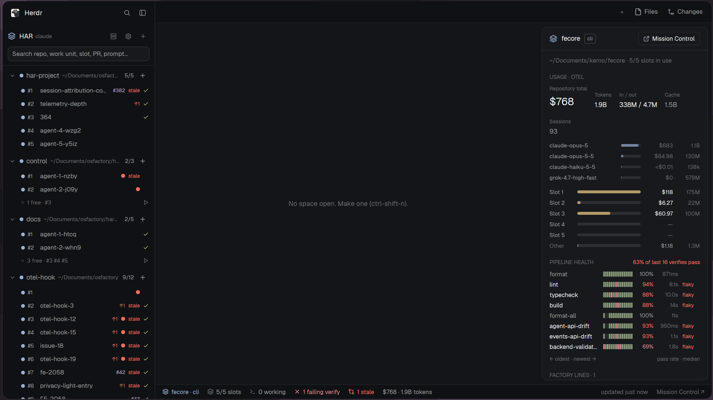
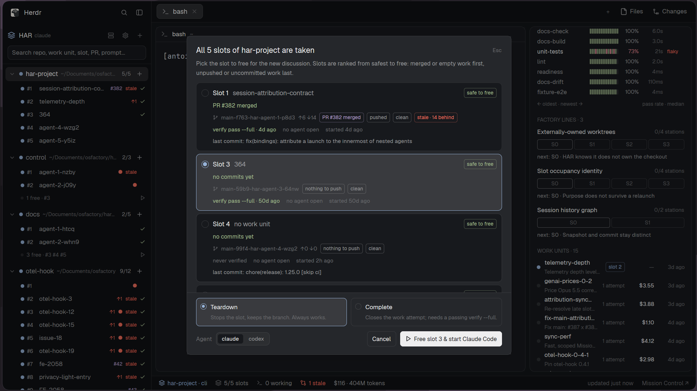
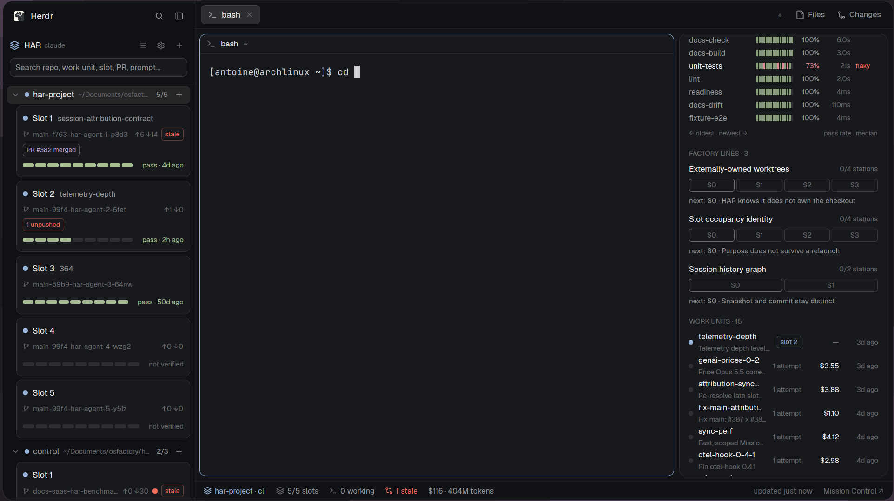
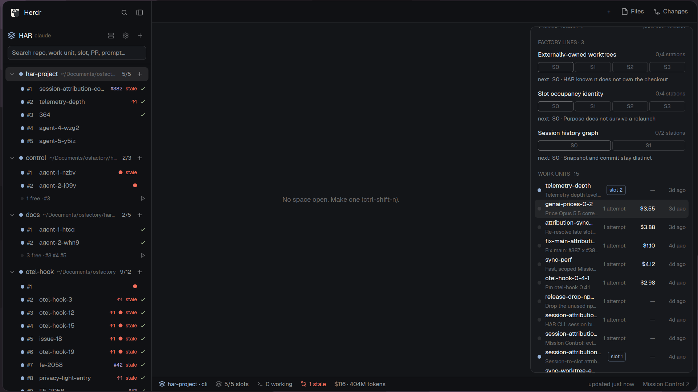

# herdr-har-ui

A [herdr](https://herdr.dev) layout for [HAR](https://github.com/os-factory/har). It puts your HAR projects, their agent slots, the coding agents running in them, the verification pipeline and OTel cost right next to your terminals.



- **Left:** every HAR project, with its slots listed underneath, one line per slot.
- **Right:** the selected project's overview (usage, pipeline health, factory lines, work units) or the selected slot.
- **Bottom:** a status bar for the selected project.

## Features

### Project tree

- Each project is one line: name, path, slots in use, a chat icon that starts the agent in the project itself (no slot), and a **+** that starts a new discussion.
- Each slot is one line: a status dot, `#id`, work unit, PR number, `↑` unpushed commits, `●` uncommitted changes, `stale`, and the last verify result.
- Under the slots, the project's Claude Code and Codex conversations that didn't run in a slot: 4 at first, **Load more** for the rest. Click one to resume it.
- One search box covers projects, slots, work units, branches, PRs, commits and agent prompts. It also finds HAR projects on this machine that you haven't added yet.
- The right panel can be hidden with the panel icon in the status bar. Gaps between panes are off by default (Settings → Spacing).
- A header button switches to detailed cards, which show the branch, ahead/behind, PR state and a strip with one cell per verification stage.

### New discussion

**+** launches the project's first free slot, then starts your agent CLI (Claude Code or Codex) inside the new worktree.

When every slot is taken, a dialog ranks the slots from safest to free to riskiest. Each slot shows PR state, push state, uncommitted changes, last verify, open agents, cost and last commit. You choose to free it with **Teardown** or **Complete**.



### Chat without a slot

The chat icon on a project row, or **Chat in repo**, starts Claude Code or Codex in the project's own checkout: no worktree, no `har env launch`. Use it to ask questions, read code or plan. Each chat is a tab in the project's `<project> · chat` space.

### Chat view

[herdr-claude-chat](https://github.com/adamentwistle/herdr-claude-chat) turns any Claude Code terminal into a chat with bubbles, tool cards, permission prompts and a composer. Press `ctrl-shift-j` or use the toggle at the right of the tab row to swap between the terminal and the chat. The session keeps running throughout.

### Overview and slot view

The **project overview** shows:
- **OTel usage:** the repo total, each model and each slot.
- **Pipeline health:** the last 16 verifies per stage, with pass rate, median duration and flaky stages.
- **Factory lines:** stations shown as pills.
- **Work units:** the slot working on each, attempts, cost and last activity.



Clicking a slot takes you back to its agent, or resumes its last Claude Code or Codex conversation when none is running. The slot view lists all of its conversations.

The **slot view** shows the work unit, branch and base, Git & PR state with a "safe to free" verdict, and usage. It also lists previews, the herdr agents in the worktree, readiness warnings and recent runs. Its verification pipeline updates live while `har env verify` runs in its tab. Its buttons are Verify --full, Verify, Open space, Start agent, Mission Control, Complete… and Teardown….



## Requirements

- herdr desktop app (`herdr-app`)
- [`@osfactory/har`](https://www.npmjs.com/package/@osfactory/har) installed globally (`npm i -g @osfactory/har`). The panel finds it through your login or interactive shell (bash, zsh, fish, nu) or the usual nvm/volta/fnm/mise/asdf/Homebrew folders. You can also set its path in Settings.
- Optional, installed by default: [herdr-web-browser](https://github.com/MattJColes/herdr-web-browser), so panel links open in a browser pane inside herdr. It's built from source, which needs Rust (`cargo`) and git. Skip it with `--no-browser`.
- Optional, installed by default: [herdr-claude-chat](https://github.com/adamentwistle/herdr-claude-chat), the chat view of a Claude Code terminal. It needs git and python3. Skip it with `--no-chat`.
- Optional: `gh`, logged in, for PR state
- Optional: Mission Control (`har control up`) for OTel cost and tokens

## Install

```bash
git clone https://github.com/os-factory/herdr-har-ui
cd herdr-har-ui
./install.sh
```

Then switch to the layout in herdr with `ctrl-shift-l` → **HAR**. On first run, the project list starts with the projects HAR already knows (`~/.har/repos.json`). Add more with **+** in the header or from the search results.

### What `install.sh` sets up

| Piece | What it is | Where |
|---|---|---|
| **HAR layout + mod** | the project tree, slot panel and status bar | `~/.config/herdr-app/layouts/har.json`, `mods/har/` |
| **[herdr-web-browser](https://github.com/MattJColes/herdr-web-browser)** | a browser that opens as a pane inside herdr. The HAR panel opens preview URLs, PRs and Mission Control in it, beside your agent, instead of switching to another app. It also adds **Browser** to herdr's **+** menu. | built from source in `~/.local/src/herdr-web-browser`, linked as `~/.local/bin/herdr-web-browser`, with its own Chrome for Testing (~200 MB) |
| **[herdr-claude-chat](https://github.com/adamentwistle/herdr-claude-chat)** | a chat view of a live Claude Code session, swapped with its terminal by `ctrl-shift-j` or the toggle in the tab row | a pinned version copied to `~/.config/herdr-app/mods/claude-chat`, with `mods/har/patches/claude-chat-linux.patch` applied so it runs on Linux; `ctrl-shift-j` added to `keys.json` if free |

The browser is a separate open-source project by Matt Coles. It needs **Rust (`cargo`) and git** to build. If they're missing, the installer skips it and links open in your normal browser; you can install it later from **Settings → Links → Install browser**.

The chat view is a separate open-source project by Adam Entwistle (MIT), built for macOS. The installer pins a known version and applies a small patch so it also runs on Linux; see the [guide](docs/guide.md#chat-view). It needs **git and python3**, and is also available later from **Settings → Chat view → Install chat**.

The browser's agent-instructions step (a "use this browser" section in Claude Code / Codex / OpenCode / Pi global instructions) is **off** unless you ask for it.

| Option | Does |
|---|---|
| `--link` | symlink instead of copy, so `git pull` updates herdr straight away |
| `--no-browser` | don't install herdr-web-browser |
| `--browser-agents` | also run the browser's agent-instructions step |
| `--no-chat` | don't install herdr-claude-chat, and leave its toggle out of the layout |

## Documentation

The **[user guide](docs/guide.md)** covers:
- every panel, and how to read the compact rows;
- what search matches;
- how slots are ranked for freeing;
- settings and key commands;
- where each number comes from;
- troubleshooting and customising the layout.

## Repository layout

```
install.sh                 copy or link into ~/.config/herdr-app
layouts/har.json           the herdr layout (sidebar tree, work area, right panel, status bar)
mods/har/main.js           views: tree, detail, status, free (dialog), settings
mods/har/data.js           data layer: har CLI, git, gh, Mission Control
mods/har/bin/              launch-agent.sh (free → launch → agent), collect.mjs (git + work units), find-tools.sh (finds har/node/gh),
                           install-browser.sh, install-chat.sh
mods/har/patches/          claude-chat-linux.patch (herdr-claude-chat on Linux and under wrappers)
mods/har/icons/            Lucide icons (ISC)
docs/                      user guide and screenshots
```

## License

Apache-2.0
