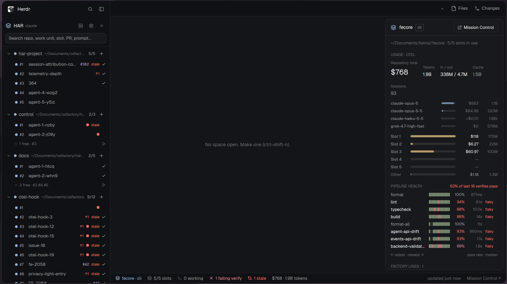
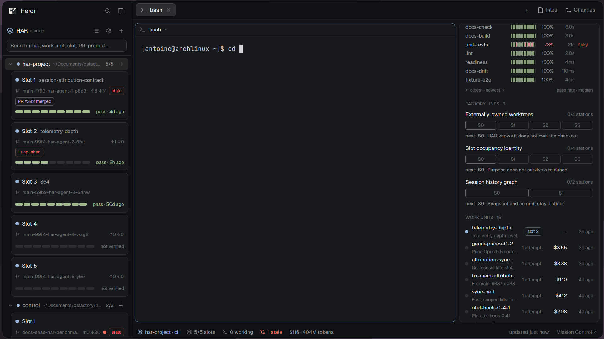
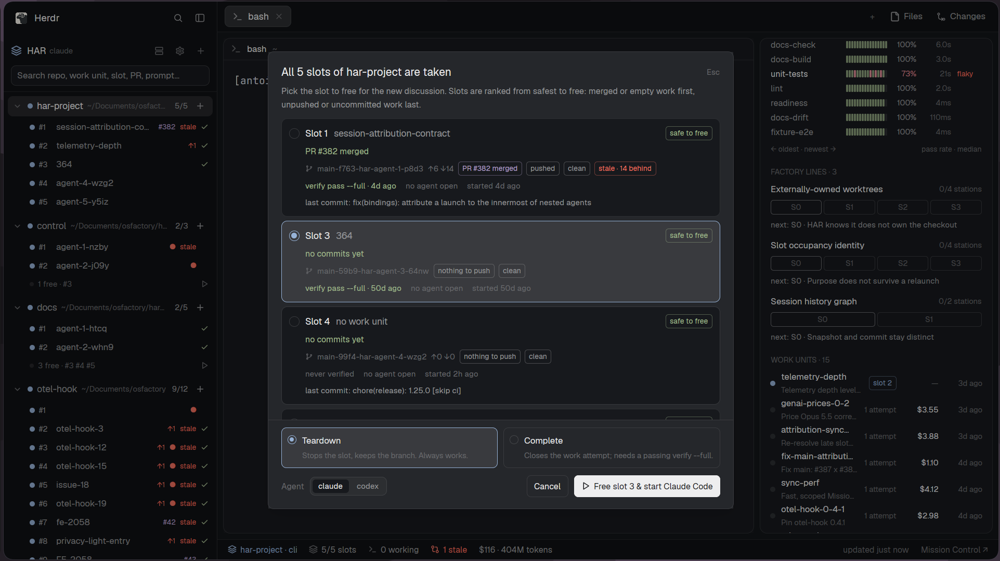
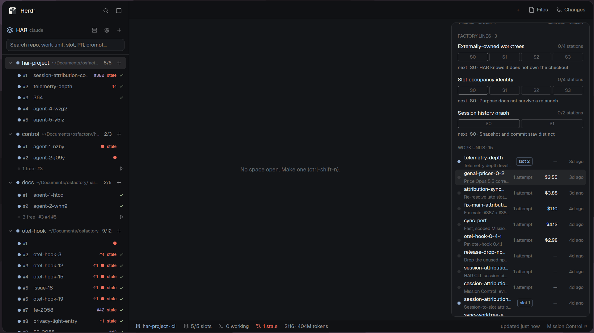

# User guide

This guide covers every part of the HAR layout for herdr: what each panel shows, where the numbers come from, and what each button runs.

- [Concepts](#concepts)
- [Sidebar: the project tree](#sidebar-the-project-tree)
- [Search](#search)
- [Starting a new discussion](#starting-a-new-discussion)
- [Freeing a slot](#freeing-a-slot)
- [Right panel: project overview](#right-panel-project-overview)
- [Right panel: slot view](#right-panel-slot-view)
- [Status bar](#status-bar)
- [Settings](#settings)
- [Key commands](#key-commands)
- [Where the data comes from](#where-the-data-comes-from)
- [Troubleshooting](#troubleshooting) (and [how the tools are found](#how-the-tools-are-found))
- [Customising the layout](#customising-the-layout)
- [Developing](#developing)

## Concepts

| Term | Meaning |
|---|---|
| **Project** | A folder with a HAR harness, which is a `.har/stages.json` file. A monorepo can hold several, such as `har-project`, `control` and `docs`. |
| **Slot** | One of a project's agent slots (`agentSlots` in `stages.json`). An active slot has its own git worktree, branch, ports and preview URLs. A free slot can be launched. |
| **Work unit** | The tracker item a slot works on, set with `har env launch --work-id …`. Each launch for the same work unit is a new attempt. |
| **Agent** | A coding agent (Claude Code, Codex, …) running in a herdr terminal. An agent belongs to a slot when its terminal's folder is inside that slot's worktree. |

## Sidebar: the project tree



### Project rows

```
⌄ ● har-project  ~/Documents/osfactory   5/5  +
```

- **⌄ / ›** opens or closes the project's slot list. Each project keeps its own open/closed state.
- **Dot:**
  - orange: an agent needs you;
  - pulsing: an agent is working;
  - red: a slot's verify failed;
  - accent colour: slots are in use;
  - grey: everything is idle.
- **Name and path:** the folder name, followed by its parent folder.
- **5/5:** active slots out of total slots.
- **+:** [starts a new discussion](#starting-a-new-discussion) in this project.

Clicking the row selects the project, and the right panel shows its overview.

### Compact slot rows (the default)

```
● #1  session-attribution-co…   #382  stale  ✓
● #2  telemetry-depth             ↑1        ✓
```

| Mark | Meaning |
|---|---|
| Dot | Status of the slot's agents, taken from the worst one: needs you (orange), working (pulsing), done, idle. Accent colour when no agent is open. |
| `#2` | Slot id |
| Text | Work unit. Without one, the agent's title, or the end of the branch name. |
| `#382` | PR for the slot's own commits. Purple: merged. Green: open. Grey: closed. |
| `↑1` | Commits not on any remote yet |
| `●` (red) | Uncommitted changes in the worktree |
| `stale` | The slot is behind its base branch |
| `needs you` | An agent in the slot is waiting for you |
| ✓ / ✗ / spinner | Last verify passed, failed, or is running now |

Hover a row for the full work unit, PR, branch and its freeing verdict. Click a row to select the slot, and to switch to its herdr space if one is open.

Free slots fold into one line, `3 free · #3 #4 #5`. Clicking it launches the first one with your agent.

### Detailed cards

The header button (list / cards icon) switches to detailed cards. Each card shows:
- the branch with ahead/behind counts;
- PR, unpushed and pushed chips;
- the slot's OTel cost and tokens;
- a strip with one cell per verification stage, coloured by its last result;
- the last verify's result and time.



## Search

The box under the header matches, without regard to case:

- project name and path;
- slot: `#2`, `slot 2`;
- work unit id and title;
- branch name;
- PR: `#382`, `pr 382`, or words from its title;
- the last commit message;
- the agent's prompt, using the title herdr gives each agent terminal (usually its first message), and the agent's name.

When a project's name or path matches, all its slots are shown. Otherwise only the matching slots are shown, and projects with no match are hidden.

Below your projects, **Other harnesses on this machine** lists matching HAR projects you haven't added. They come from `~/.har/repos.json` plus a scan of your home folder five levels deep. Clicking one adds it.

## Starting a new discussion

The **+** on a project row, or the key command `har.new`:

1. With a free slot, it opens a new herdr space named `<project>#<slot>` running `mods/har/bin/launch-agent.sh`, which:
   - runs `har env launch <slot> --repo <project>` with its full output visible;
   - reads the new worktree from `har env status --json`;
   - `cd`s into it and starts the agent CLI chosen in [Settings](#settings).
2. With no free slot, it opens the [slot chooser](#freeing-a-slot).

If the launch fails, the space stops at a shell with the error. If the agent exits, you're left in a shell **inside the slot's worktree**, with the command to rerun it.

## Freeing a slot



The chooser lists every slot of the project, safest to free first. Each slot gets a verdict:

| Verdict | When |
|---|---|
| **free** | The slot is not in use |
| **safe to free** | Its PR is merged or closed, its commits are already on the base branch, or it has no commits yet |
| **check first** | Its commits are pushed or in an open PR, but not merged |
| **keep** | An agent is working or waiting in it, the worktree has uncommitted changes, or it has unpushed commits |

Each row also shows:
- the branch and ahead/behind;
- PR state, which you can click to open the PR;
- pushed / unpushed / nothing to push, and clean / uncommitted;
- stale;
- the last verify, open agents, cost, when it started, and the last commit.

Pick how to free the slot:

- **Teardown:** runs `har env teardown <slot>`. Stops services and frees the slot, keeping the branch. Always works.
- **Complete:** runs `har env complete <slot>`. Closes the work attempt as well, and needs a passing `verify --full`.

The button then frees the slot, launches it and starts your agent, all in one visible terminal. Choosing a **keep** slot asks you to click twice.

`har.choose` opens the chooser even when a slot is free, so you can pick which slot to use.

## Right panel: project overview

Shown when a project is selected and no slot is.

### Usage · OTel

- The **repository total**: cost, tokens, input/output, cache reads and sessions.
- The **models** ranked by cost.
- A **bar per active slot**. Click one to open that slot.
- **Other:** usage in the project that couldn't be matched to a slot, for example sessions run in the main checkout.

The numbers come from Mission Control, which collects the agents' OTel exports. If Mission Control isn't running, this section says so.

### Pipeline health

One row per verification stage. Each row shows the last 16 verify runs as cells, oldest to newest:
- green: passed;
- red: failed;
- dim: skipped;
- empty: not run, e.g. a full-only stage in a quick verify.

Then the stage's pass rate, its median duration, and **flaky** when it both passed and failed in that window. The header gives the share of those verifies that passed.

### Factory lines

One block per installed line (`har line status --json`), with stations as pills:
- green: passed;
- red: a required stage failed;
- orange: a required stage is missing;
- grey: not run yet.

Hover a pill for the station's title and failing stages. "next:" names the first station that isn't green.

### Work units



The most recent work units first, from `.har/work-units/` and `.har/work-attempts/`. Each row shows the id and title, the slot working on it now (click to open that slot) or its number of attempts, its OTel cost, and its last activity.

## Right panel: slot view

Shown when a slot is selected. Press **×** or use `har.overview` to go back.

- **Header:** slot id, active/free, stale, "harness bypassed" (when the slot shows signs of work done outside the harness), work unit and title, branch, base commit, worktree path.
- **Buttons:**
  - **Verify --full** / **Verify:** run `har env verify` in a background tab in the slot's space. The pipeline below updates live.
  - **Open space / Go to space:** the herdr space for the worktree.
  - **Start \<agent\>:** opens your agent CLI in the worktree.
  - **Logs:** only shown when the harness defines a `logs` stage.
  - **Mission Control:** opens this slot's page in Mission Control.
  - **Complete… / Teardown…:** ask before running.
- **Git & PR:** PR (click to open), ahead/behind, unpushed, clean/uncommitted, merged into base, PR title, last commit, remote branches, and the [freeing verdict](#freeing-a-slot) with its reasons.
- **Usage · OTel:** this slot's cost, tokens and models.
- **Previews:** the slot's preview URLs. Click to open.
- **Agents in this slot:** herdr agents whose terminal is in the worktree. Click to focus one.
- **Verification pipeline:** each stage with ✓ / ✗ / skipped / running, a duration bar and its time. "full only" marks stages a quick verify skips. **show** jumps to the verify tab.
- **Readiness:** warnings from `har env status`, such as untracked paths that won't be in the worktree.
- **Runs:** the slot's last 6 runs. Click one to open `har env runs get <id>` in a tab.

## Status bar

The selected project and its profile, slots in use, agents working, agents needing you, failing verifies, stale slots, the project's OTel cost and tokens, when the data was last refreshed, and a Mission Control link.

## Settings

Open them with the gear in the tree header, or `har.settings`.

| Setting | Values |
|---|---|
| Slot view | **Compact** (one line per slot) or **Detailed** (cards) |
| Agent CLI | Any installed agent herdr knows, e.g. `claude`, `codex`. Used by new discussions, Launch and Start agent, and shown next to "HAR" in the header. |
| Free slots | Show or hide free slots under each project |
| Tools | Shows where `har`, `node` and `gh` were found and how. **har path** / **node path** set them by hand (`~/` works); leave them empty to find them automatically. **Save paths** looks again right away. |

Settings, the project list and which projects are open are saved in herdr's shared state, so they survive restarts.

## Key commands

Bind them in `~/.config/herdr-app/keys.json`, for example `"alt-n": "har.new"`.

| Command | Does |
|---|---|
| `har.new` | New discussion in the selected project |
| `har.choose` | Open the slot chooser |
| `har.slot-1` … `har.slot-N` | Select a slot |
| `har.overview` | Back to the project overview |
| `har.verify` / `har.verify-full` | Verify the selected slot |
| `har.open` | Open the selected slot's space |
| `har.agent` | Start the agent CLI in the selected slot |
| `har.toggle-view` | Compact ↔ detailed |
| `har.settings` | Open settings |
| `har.refresh` | Refresh now |
| `har.next-repo` | Select the next project |

## Where the data comes from

| Data | Source | Refreshed |
|---|---|---|
| Slots, branch, ahead/behind, dirty, stale, previews, readiness | `har env status --json` | 10 s for the selected project, 30 s for the others |
| Runs and per-stage results | `har env runs list --json` (last 80) | same |
| Verification stage order | `.har/stages.json` → `verificationStages` | same |
| Live pipeline | the verify tab's terminal output, read every 1.5 s while it runs | live |
| Factory lines | `har line status --json` | same |
| Work units and attempts | `.har/work-units/*.json`, `.har/work-attempts/*.json` | same |
| Unpushed commits, remote branches, merged into base, changed files, last commit | `git` in each slot worktree (`mods/har/bin/collect.mjs`) | same |
| PRs | `gh pr list --state all` (last 100) | at most once a minute |
| Cost and tokens | Mission Control `GET /api/repos/:id/usage` | same as slots |
| Agents and their status | herdr itself (`agents()`, `panes()`) | live |

The panels only change anything through the HAR commands you click (launch, verify, complete, teardown), and each one runs in a visible herdr terminal.

A PR is matched to a slot only when the slot has commits of its own, by branch name, a remote branch carrying its commits, or the PR's head commit. A fresh slot sits on the base branch's latest commit and never borrows another branch's PR.

## Troubleshooting

| Symptom | Fix |
|---|---|
| "`har` not found" (red box in the sidebar) | The box lists every place the panel looked. Install HAR with `npm i -g @osfactory/har`, or open **Set har path…** and paste the output of `command -v har` from your terminal (and `command -v node` if `node` isn't next to it). Then press **Retry**. See [How the tools are found](#how-the-tools-are-found). |
| Usage says "Mission Control is not running" | `har control up`, or check `http://localhost:3847` |
| Slot usage shows "—" while "Other" is large | Mission Control couldn't match those sessions to a slot, e.g. they ran in the main checkout. That's how Mission Control attributes usage; the panel only displays it. |
| "PRs unknown (gh)" | Install `gh` and run `gh auth login`. Projects whose remote isn't on GitHub show no PRs. |
| No Logs button | The harness has no `logs` stage, so `har env logs` would fail. |
| The layout didn't change after editing `har.json` | Switch away and back (`ctrl-shift-l`), or run `herdr-app do layout.switch --name har`. |
| A panel shows a render error | Run `herdr-app check ~/.config/herdr-app/mods/har` for the stack trace. |
| The agent closed right after the launch | You're in a shell in the worktree. Rerun the command printed above the prompt, then check the agent's own output. |

### How the tools are found

herdr starts its panels with its own PATH, which usually lacks what your shell setup adds (nvm, volta, fnm, mise, asdf, Homebrew…). `mods/har/bin/find-tools.sh` looks for `har`, `node` and `gh` in this order and stops as soon as `har` and `node` are both found:

1. **Settings:** the har path and node path, if you set them.
2. **Your login shell:** `$SHELL -l`, asked in its own syntax (sh, bash, zsh, fish and nu all work). This covers `~/.zprofile`, `~/.bash_profile`, `~/.profile` and fish's `config.fish`.
3. **Your interactive shell:** `bash -i` or `zsh -l -i`, for setups that only live in `~/.bashrc` or `~/.zshrc` (where the nvm and volta installers put themselves). It runs in its own session with no terminal (`setsid`, or `perl` when `setsid` is missing), so it can't take over herdr's terminal.
4. **The usual install folders:** nvm (newest version first), volta, fnm (Linux and macOS), mise, asdf, nodenv, n, bun, `~/.npm-global/bin`, `~/.local/bin`, `/opt/homebrew/bin`, `/usr/local/bin`, `/usr/bin`.

When `har` is found, `node` is taken from the same folder if it's there, so both come from the same nvm/fnm version. Every command the panels run, including the terminals they open, then starts with those folders first on PATH. That's why volta and asdf shims and `#!/usr/bin/env node` scripts work.

To see what the panel will find, run the script yourself with a minimal environment, like herdr's:

```bash
env -i HOME="$HOME" PATH=/usr/bin:/bin sh ~/.config/herdr-app/mods/har/bin/find-tools.sh
```

It prints `har=`, `node=`, `gh=`, `how=` (which step found them) and a `tried=` line for each step that didn't.

## Customising the layout

`layouts/har.json` is a normal herdr layout:

- `har-tree`: the sidebar (`"view": "tree"`). Its `props.repos` can list the first projects to show, e.g. `["~/code/app", "~/code/app/web"]`. Leave it empty to start from `~/.har/repos.json`. Once you edit the list in the panel, the saved list wins.
- `har-panel`: the right panel (`"view": "detail"`). Change `size.px` to resize it, or delete the block to hide it.
- `status`: the status bar (`"view": "status"`).

The same mod also has a `free` view (the slot chooser dialog) and a `settings` view (the settings dialog), which open as overlays.

## Developing

```bash
./install.sh --link                       # herdr reads the mod from this checkout
herdr-app types ~/.config/herdr-app/mods/har   # writes gpui-kit.d.ts for editor completion (git-ignored)
herdr-app check ~/.config/herdr-app/mods/har   # load + render check
herdr-app shot /tmp/har.png                    # screenshot the running app
```

herdr reloads a mod when its files change. Mods are gpui-kit JavaScript. `~/.config/herdr-app/AGENTS.md` and `herdr.d.ts` describe the API.
